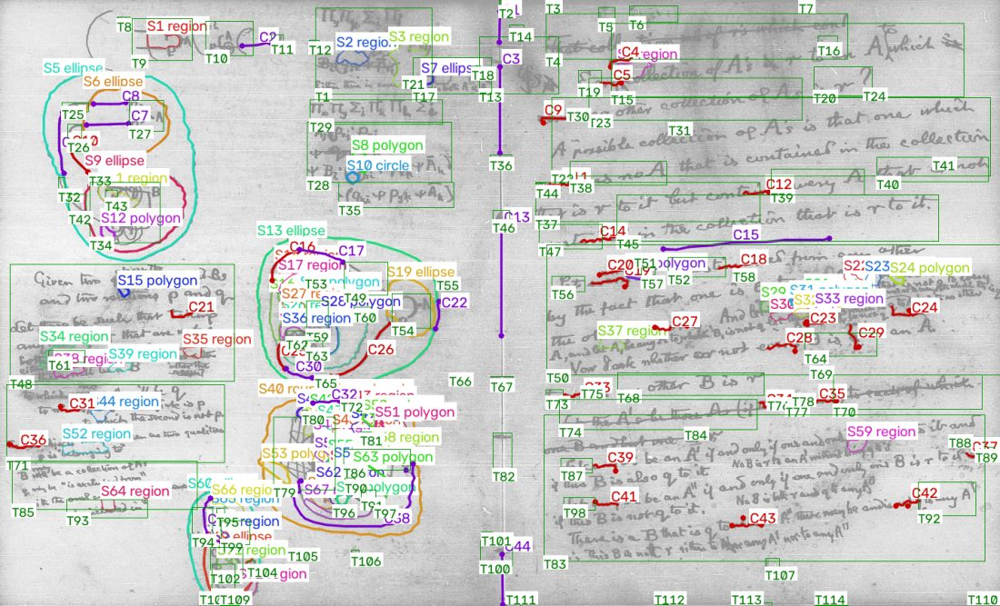
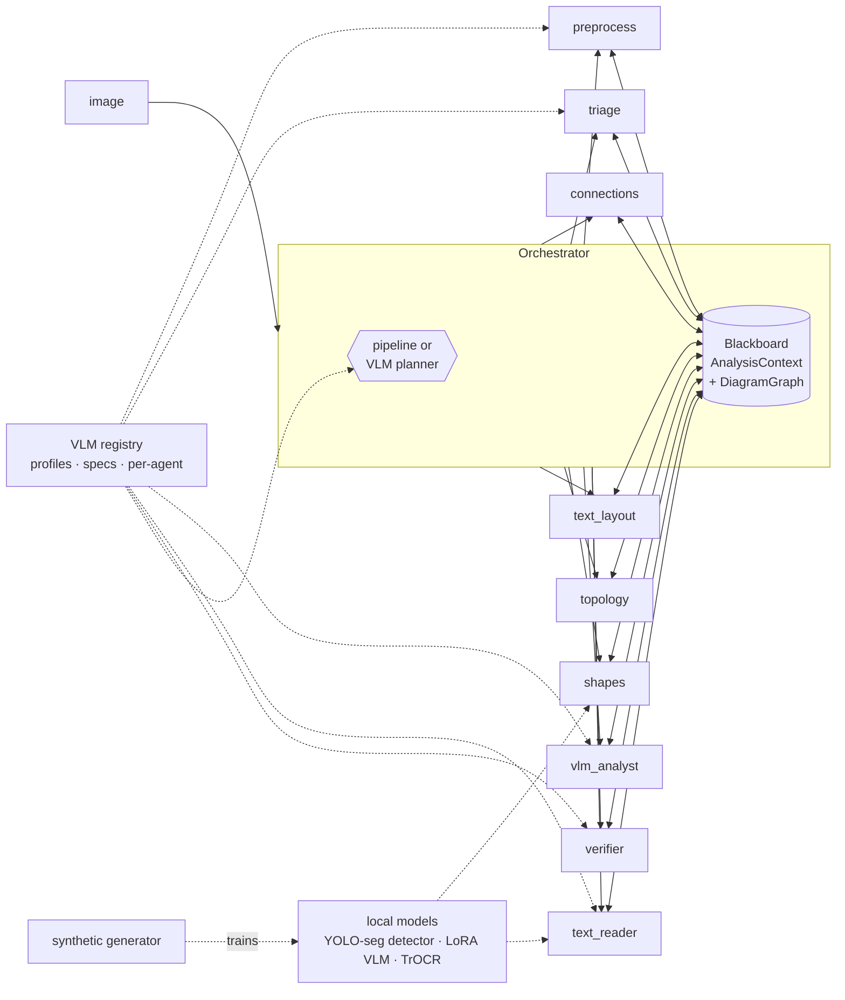
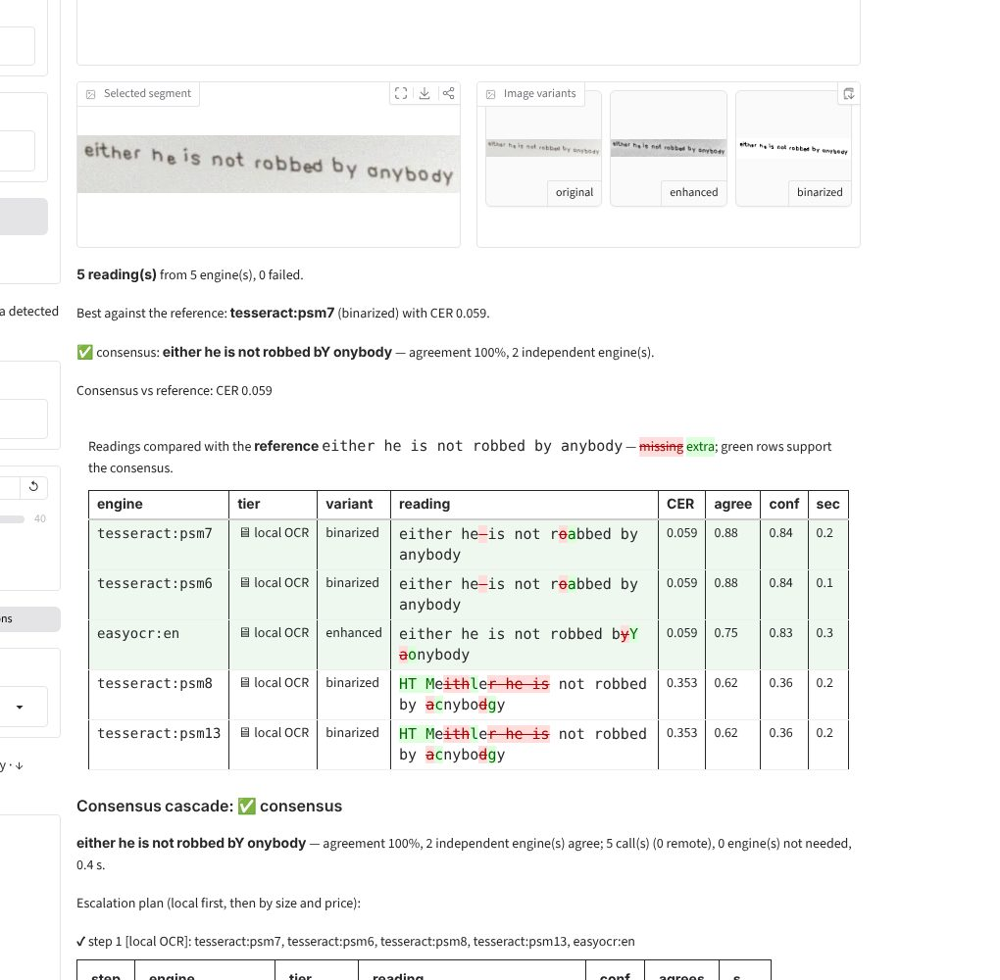
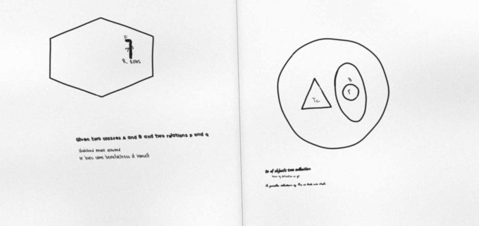
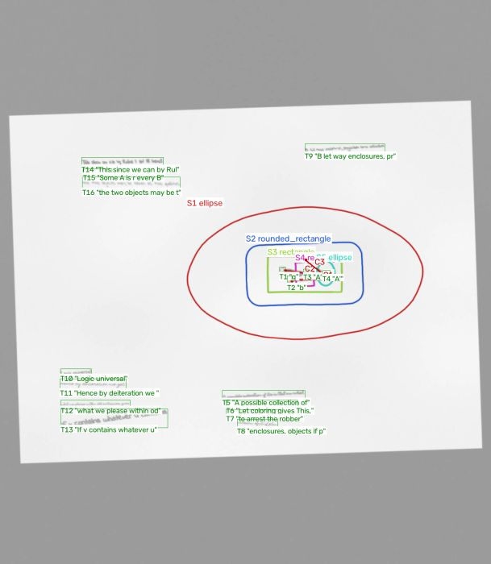
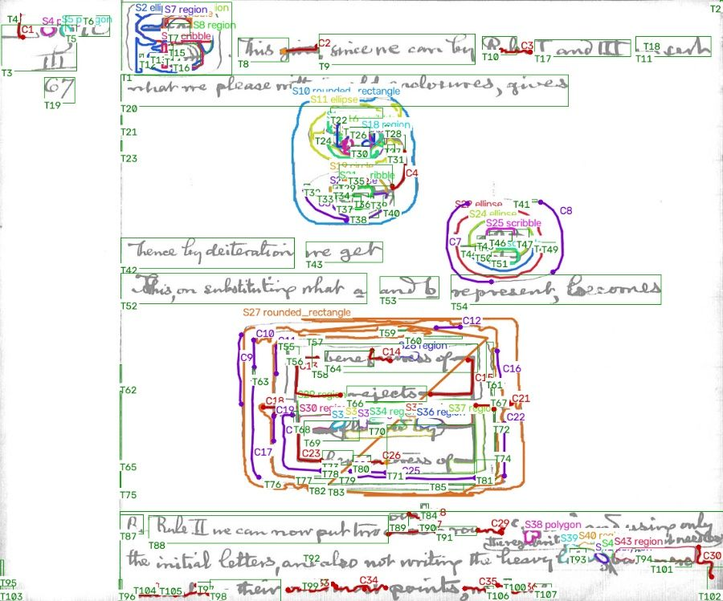

# identify_drawing_from_image

Agentic pipeline that looks at a picture and works out whether it contains a **hand drawing**. If it does, it identifies:

* **which shapes** are drawn: ellipse, circle, rectangle, rounded rectangle, triangle, diamond, polygon, an irregular closed region or a scribble
* **how the shapes relate**: nesting (which shape contains which, to any depth), overlaps and touching outlines
* **how they are connected**: lines, arrows and heavy "lines of identity", including what each line end is attached to and which outlines it crosses
* **what is written inside and near each shape**, and labels written on lines

The examples in [`examples/images`](examples/images) are scans of Charles S. Peirce's logic notebooks (existential graphs). They cover the hard cases: microfilm frames, two-page spreads, ruled and stained paper, pages rotated by 90°, nested ovals crossed by heavy lines, crossed-out words and scribbles.

Classical computer vision does the geometry, a **pluggable VLM** of your choice (Claude, GPT, Gemini, Ollama, vLLM/LM Studio, local HuggingFace models, or none at all) does the reading and judging, and **local models trained on synthetic images** fill the gaps.



*Classical CV pass only, no VLM: nested ovals (S#), heavy lines and connectors (C#), and text regions (T#) to be read.*

---

## Architecture



Agents never call each other. They read and write a shared **blackboard** (the `AnalysisContext` with the `DiagramGraph` being built), and the **orchestrator** decides who runs next:

* `pipeline` mode (default) runs a fixed plan, then a **verification loop**. The verifier VLM sees the drawing next to a numbered overlay of the current detections ("set-of-marks"), corrects them, and can ask agents to re-run (for example, a relaxed shape re-scan or a re-read of the text).
* `planner` mode lets a VLM pick the next agent at every step, based on the blackboard state, the agent descriptions and the history. Invalid or premature choices fall back to the default plan, so a weak planner can't break the run.

| agent | does | uses |
|---|---|---|
| `preprocess` | finds the page in a microfilm frame, fixes the orientation (classical guess, confirmed by the VLM), flattens stains and lighting, binarises the ink, removes ruled lines and gutters | CV + VLM |
| `triage` | decides whether the image is a hand drawing or diagram rather than a photo or plain text | CV + VLM |
| `shapes` | finds closed outlines (enclosed areas, merged when lines cut them, plus filled outlines for cluttered interiors; pen gaps are bridged) and classifies them by IoU against fitted primitives. Can fuse a locally trained YOLO-seg detector | CV + local model |
| `connections` | erases outlines, separates connectors from handwriting by skeleton statistics, extracts heavy lines of identity by stroke width, detects arrow heads, and re-joins lines cut at outlines | CV |
| `text_layout` | groups the remaining ink into words and lines without crossing outlines | CV |
| `topology` | computes direct containment and depth, overlaps and touching shapes, inside/near placement of text, line-end attachment (text, outline, interior or free), crossed outlines and line labels | geometry |
| `vlm_analyst` | holistic VLM reading of the whole page, fused with the geometry: confirms or corrects types and adds missed shapes, texts and connections | VLM |
| `text_reader` | transcribes every text region from crops (batched, or a labelled sheet for single-image VLMs) with the agent's VLM, a local OCR (Tesseract, EasyOCR, TrOCR), or the **consensus cascade**: local and small engines first, bigger and cloud models only for the regions they disagree on | VLM / OCR |
| `verifier` | set-of-marks critique: remove, retype or add shapes, fix transcriptions, add or remove connections, request re-runs | VLM |

Without any VLM the classical agents still produce a full structural graph: shapes, nesting, connections and text locations. Only the transcriptions are missing.

## Run it on your PC

No setup knowledge needed: the launcher creates a private Python environment in `.venv`, installs everything, downloads the handwriting fonts and opens the web UI at http://127.0.0.1:7860.

1. Install **Python 3.10 or newer** (Windows: `winget install Python.Python.3.12`, or python.org with "Add python.exe to PATH" ticked; macOS: `brew install python`).
2. Download the code: `git clone https://github.com/marcomaggiotti/identify_drawing_from_image`, or GitHub's *Code → Download ZIP* and unzip it.
3. Start it:
   * **Windows:** double-click `start.bat`.
   * **macOS / Linux:** run `./start.sh` in a terminal.

   The first run installs about 1–2 GB of packages (mostly PyTorch for EasyOCR) and takes a few minutes. Later runs start in seconds.

| Command | What it does |
|---|---|
| `start.bat` / `./start.sh` | UI, local OCR (Tesseract, EasyOCR, TrOCR) and the Claude / GPT / Gemini clients |
| `start.bat full` | also local HuggingFace VLMs and the YOLO detector (large download; a GPU helps) |
| `start.bat update` | reinstall after downloading newer code |

Everything works offline with the classical pipeline. Optional extras:
* **Tesseract** (the fastest local OCR tier): `winget install UB-Mannheim.TesseractOCR`, `brew install tesseract` or `sudo apt install tesseract-ocr`. The app finds it in its default Windows folder; set `TESSERACT_CMD` if it is installed somewhere else.
* **A free local VLM**: install [Ollama](https://ollama.com/download), then run `ollama pull qwen2.5vl:3b` (or `qwen2.5vl:7b` with 16 GB RAM or more). The profiles `ollama-qwen-small` and `ollama-qwen` then appear as available, and the consensus uses them before any cloud model.
* **Cloud models**: create a file named `.env` next to the launcher with lines such as `ANTHROPIC_API_KEY=sk-ant-...`, `OPENAI_API_KEY=...` or `GEMINI_API_KEY=...`. It is git-ignored, and the launcher loads it.

The command line works from the same environment: `.venv\Scripts\drawid analyze page.jpg` on Windows, `.venv/bin/drawid analyze page.jpg` on macOS / Linux.

## Install

```bash
pip install -e .                    # core: numpy, opencv, scikit-image, scipy, pydantic, pyyaml
pip install -e '.[anthropic]'       # + Claude      (or [openai], [gemini])
pip install -e '.[hf]'              # + local HuggingFace VLMs / LoRA fine-tuning
pip install -e '.[yolo]'            # + the local detector (ultralytics)
pip install -e '.[ui]'              # + web UI (gradio)
pip install -e '.[ocr]'             # + local OCR engines (pytesseract + easyocr; also: apt install tesseract-ocr)
pip install -e '.[all,dev]'
drawid fonts                        # free handwriting fonts for the synthetic generator (Google Fonts, OFL)
```

## Quick start

```bash
drawid analyze examples/images/robber_policeman_graph.jpg --vlm claude --print
drawid analyze examples/images/ --no-vlm --out outputs/        # classical CV only
drawid ui                                                      # web UI with VLM drop-downs
```

Each image produces the following in `--out`:

| file | content |
|---|---|
| `NAME.json` | the full `DiagramGraph`: shapes, connections, texts, relations, agent trace |
| `NAME_overlay.png` | detections drawn over the page |
| `NAME.md` | plain-English structure, agent trace, Mermaid diagram |
| `NAME.dot` / `NAME.mmd` | Graphviz (nested clusters) and Mermaid exports |
| `NAME_working.png` | the cropped/rotated page that all coordinates refer to |

Python:

```python
from drawing_identifier import analyze, Orchestrator, load_config

res = analyze("page.jpg", vlm="ollama:qwen2.5vl:7b")
for s in res.graph.shapes:
    print(s.id, s.type.value, "inside", s.parent_id, "texts:", [res.graph.text(t).text for t in s.text_inside])
for c in res.graph.connections:
    print(c.id, "heavy" if c.heavy else c.type.value, "joins", c.attached_ids(), "crossing", c.crosses)
```

## Choosing the VLM

```bash
drawid vlms        # profiles, providers, and which ones are usable right now (keys / servers found)
drawid agents --vlm claude --agent-vlm text_reader=ollama-qwen   # who would use what
```

* **Profiles.** `claude`, `claude-sonnet`, `claude-haiku`, `gpt`, `gemini`, `ollama-qwen-small`, `ollama-qwen`, `ollama-llama`, `vllm-qwen`, `hf-qwen`, `local-finetuned` and `mock`. Add your own in a YAML file (see [`configs/example.yaml`](configs/example.yaml)).
* **Ad-hoc specs.** `provider:model[@base_url]`, for example `anthropic:claude-opus-5-5`, `openai:gpt-5`, `gemini:gemini-2.5-pro`, `ollama:qwen2.5vl:7b@http://gpu-box:11434`, `vllm:Qwen/Qwen2.5-VL-7B-Instruct`, `lmstudio:<model>`, `openrouter:<model>` or `hf:Qwen/Qwen2.5-VL-3B-Instruct`.
* **`auto`** (the default) picks the first usable entry in `auto_preference`. **`none`** runs classical CV only.
* **Per agent.** Use `--agent-vlm verifier=claude --agent-vlm text_reader=ollama-qwen`, or `agent_vlms:` in the config. For example, a cheap local model can read hundreds of crops while a strong model verifies and plans. `planner` is a valid agent name too.
* **Web UI.** `drawid ui` has a global VLM drop-down (or a custom spec) and per-agent drop-downs.
* Each profile also sets `max_image_side`, `max_images_per_call`, `bbox_format` (`xyxy_1000`, `yxyx_1000` or `xyxy_pixels`), `temperature`, `max_tokens` and `extra` (request parameters, `adapter_path` for LoRA weights, `device_map`, `dtype` …).
* For the consensus cascade, profiles can also set `local`, `params_b` (model size), `cost_rank` (0 free … 5 most expensive) and `weight` (vote weight). These are inferred when not set: `hf`, `ollama` and `localhost` servers are local, the size comes from the model name (`qwen2.5vl:7b` → 7B), and the price from the model family (haiku / flash < sonnet / gpt-5 / pro < opus).

## Transcription benchmark and consensus

### Benchmark tab

`drawid ui` → **Benchmark** tab: select a segment and compare every way of reading it, in one view.



1. **Pick a page.** Upload one, choose an example, or load a synthetic sample whose true text is known (it fills in the reference).
2. **Select the segment.** Click two corners on the page, pick one of the text regions found by **Detect text regions** (rotated pages are turned upright), or type coordinates. You can also rotate the segment and set the padding.
3. **Choose the engines.** Every configured VLM profile, extra VLM specs you type in, Tesseract in 4 page modes, EasyOCR and 4 TrOCR checkpoints. Each engine can run on 3 image variants: original, contrast-enhanced and binarised. Engines that can't run here are listed with how to enable them (API key, `ollama pull`, `pip install` …).
4. **Optionally type the reference** (the ground truth).
5. **Compare all selected engines** runs every engine × variant in parallel. One table shows each reading with a character diff against the reference, or against the consensus when there is no reference. It also shows CER, agreement with the other engines, confidence and time. Rows that support the consensus are green. Change the reference and press **Re-score**: nothing is re-run. Results download as JSON and CSV.
6. **Consensus cascade** shows the escalation plan, which engines were called, what each one read, and which ones weren't needed.

The same from the command line:

```bash
drawid engines                                         # every engine, in consensus order, with availability
drawid transcribe page.jpg --box 105,478,528,543 --variants original,binarized --reference "Some A is r every B"
drawid transcribe page.jpg --box 105,478,528,543 --consensus --engines auto          # local first, cloud only if needed
drawid transcribe page.jpg --box ... --consensus --no-remote --json result.json      # never leave the machine
```

### Consensus between engines: local first, small to expensive

Engines are ordered **local before remote**, then by size and price, and grouped in tiers:

| tier | engines (default config) | default vote weight |
|---|---|---|
| 0 local OCR | Tesseract (4 page modes), EasyOCR, TrOCR (small / base / large) | 0.6 |
| 1 local VLM ≤ 4B | `ollama-qwen-small` (qwen2.5vl:3b), `hf-qwen` (Qwen2.5-VL-3B), `local-finetuned` | 1.0 |
| 2 local VLM > 4B | `ollama-qwen` (7B), `vllm-qwen` (7B on localhost), `ollama-llama` (11B) | 1.3 |
| 3 cloud, cheap | `claude-haiku`, `gemini` (flash) | 1.5 |
| 4 cloud, mid | `claude-sonnet`, `gpt` | 2.0 |
| 5 cloud, top | `claude` (opus) | 2.5 |

The cascade runs the cheapest tier, votes, and **escalates only if the answers so far don't agree**:

* **Similar readings form one cluster.** Two readings belong together when their normalised edit-distance similarity is at least `similarity` (0.85 by default).
* **A cluster wins when it has enough independent support.** It needs at least `min_agree` independent engine families (2 by default) and at least `agreement` of the weighted vote (60% by default). Weights grow with the tier and are scaled by each engine's confidence.
* **An engine can't vote with itself.** Several modes of one engine (Tesseract's page modes, the TrOCR checkpoints) collapse into a single vote.
* **The final text depends on how many engines agree.** With three or more, it is a word-level weighted vote (ROVER-style), so they correct each other's slips. Otherwise it is the reading of the strongest supporting engine.
* **Only disputed segments go up.** On a page with many text regions, only the regions still in dispute are sent to the next tier, so the expensive models only see the hard cases.
* **Cloud calls can be ruled out.** `allow_remote: false` never leaves the machine. `max_tier` caps the escalation, and `per_engine` escalates one engine at a time instead of a whole tier.
* **No consensus is labelled honestly.** When nothing agrees, the answer is returned as `best_effort` with its agreement share, instead of being presented as certain.

Use it in the pipeline with `--ocr consensus`, or set `text.ocr: consensus`. Each text item then records `attributes.consensus` (status, agreement, supporting engines, tiers run), and the trace says how many regions were settled locally and how many remote calls were made. The settings live in the `consensus:` section of the config.

API keys are read from environment variables (`ANTHROPIC_API_KEY`, `OPENAI_API_KEY`, `GEMINI_API_KEY`, or the profile's `api_key_env`). Never put keys in config files.

## Synthetic training data

 

`drawing_identifier/synthetic` renders pages from a random **scene graph** modelled on the examples:

* **shapes:** nested containers ("cuts") up to depth 4, laid out concentrically or side by side; ellipses, circles, rectangles, rounded rectangles, triangles, diamonds and polygons; Venn-style overlaps
* **hand-drawn look:** smooth wobble, pen lifts, overshoot and small gaps where the outline closes, varying pen pressure
* **labels:** inside shapes (letters, subscripts, predicate words from Peirce's notebooks) and next to them
* **connections:** heavy lines of identity between labels (curved or elbowed, some branching into three ends, some dangling), shape-to-shape lines and arrows, and arrows between diagrams
* **distractors:** paragraphs of handwriting (20 handwriting fonts, or pen-restroked OpenCV fonts), crossed-out lines, scribbles over shapes, bleed-through from the back of the page
* **paper and scanning:** ruled paper with margins, two-page spreads with a gutter, stains, microfilm frames, skew, 90° rotations, grayscale or high-contrast film, blur, noise and JPEG artefacts

The ground truth is exact, because the generator knows what it drew. Every page comes with a full `DiagramGraph`: polygons, nesting, text with transcriptions and placement, and connections with their attached ends.

```bash
drawid synth --preview 6 --out outputs/preview          # look at a few pages + ground-truth overlays
drawid synth -n 5000 --out data/synth --workers 8       # ~0.35 s/page/core
```

| output | for |
|---|---|
| `images/{train,val}`, `annotations/{train,val}/*.json` | everything (ground-truth graphs) |
| `labels/` + `data.yaml` | **YOLO-seg** detector (11 classes: 7 shape types, scribble, line, arrow, text) |
| `coco_{train,val}.json` | any COCO instance-segmentation trainer (Detectron2, MMDet …) |
| `vlm_{train,val}.jsonl` | **VLM fine-tuning**: chat samples whose answer is exactly the JSON the `vlm_analyst` agent asks for |
| `ocr/{train,val}` + `.tsv` | handwriting crops with transcriptions (TrOCR-style fine-tuning) |

## Training the local models

```bash
# 1. shape / line / text detector (YOLO-seg). CPU works for small runs; use a GPU for real ones
drawid train-detector --data data/synth/data.yaml --epochs 50 --imgsz 1024 --device 0
drawid analyze page.jpg --detector cv+yolo --weights models/detector.pt

# 2. a local VLM that speaks the agents' JSON (LoRA on Qwen2.5-VL by default; needs a GPU)
drawid finetune-vlm --data data/synth --base Qwen/Qwen2.5-VL-3B-Instruct --out runs/vlm-lora
drawid analyze page.jpg --vlm local-finetuned          # profile points at runs/vlm-lora
```

## Evaluating and comparing VLMs

```bash
drawid eval --data data/synth --split val --limit 50 --no-vlm
drawid benchmark --data data/synth --vlm none --vlm claude --vlm ollama-qwen --vlm local-finetuned --limit 30 --report outputs/bench.md
```

Predictions are mapped back to the original pixel coordinates (undoing crop, scale and rotation) and matched to the ground truth. The benchmark reports:

* shapes: precision, recall and F1 (mask IoU ≥ 0.5, Hungarian matching), plus exact and family type accuracy
* containment F1
* text: detection F1, CER and exact-match rate, and accuracy of "inside which shape"
* connection F1, on the pairs of elements each line joins
* seconds per image

### Results so far

Held-out synthetic pages: 50 validation pages of a 500-page set, with no VLM. The local detector is a YOLO11n-seg trained for 30 epochs on the 450 training pages, on CPU at 800 px (about 2.5 h on 4 cores):

| system | shapes P/R/F1 | type acc | family acc | containment F1 | texts F1 | text CER | inside acc | connections F1 | s/img |
|---|---|---|---|---|---|---|---|---|---|
| classical CV | 0.89/0.85/0.87 | 0.91 | 0.95 | 1.00 | 0.66 | - | 0.96 | 0.17 | 0.60 |
| CV + local YOLO | 0.90/1.00/0.95 | 0.91 | 0.95 | 0.98 | 0.67 | - | 0.93 | 0.21 | 1.00 |
| local YOLO only | 0.99/0.99/0.99 | 0.91 | 0.96 | 0.90 | 0.66 | - | 0.77 | 0.23 | 0.82 |

* The trained detector closes most of the classical detector's gaps on shapes: recall goes from 0.85 to 1.00 with `cv+yolo`.
* Classical outlines give tighter polygons and therefore better nesting, which is why `cv+yolo` is recommended over `yolo` alone.
* Reading the text (CER) and connections need a VLM. Without one, the text is located but not read.

The detector also transfers to the real scans. On `rotated_nested_rectangles.jpg`, `cv+yolo` finds the large nested rounded rectangles and nested ovals that the classical pass alone misses. It also fires a few false "scribble" detections:



To reproduce:

```bash
drawid synth -n 500 --seed 7 --out data/synth500
drawid train-detector --data data/synth500/data.yaml --epochs 30 --imgsz 800 --device cpu
drawid benchmark --data data/synth500 --vlm none --limit 50 --detector cv+yolo --weights models/detector.pt
```

## Output schema (abridged)

```json
{
  "image": {"width": 1427, "height": 865, "rotation": 0, "crop": {...}, "scale": 1.0, "stroke_width": 1.8},
  "is_drawing": true,
  "shapes": [{"id": "S5", "type": "ellipse", "bbox": {...}, "polygon": [[x, y], ...], "parent_id": null, "depth": 0,
              "text_inside": ["T25"], "text_near": ["T9"], "crossed_out": false, "confidence": 0.92, "source": ["cv", "vlm"]}],
  "connections": [{"id": "C3", "type": "line", "heavy": true, "path": [[x, y], ...],
                   "endpoints": [{"point": [x, y], "text_id": "T25", "shape_id": "S6", "attachment": "text"}, ...],
                   "crosses": ["S6"], "label_ids": []}],
  "texts": [{"id": "T25", "text": "loves", "placement": "inside", "inside_shape_id": "S5", "near_shape_ids": ["S6"], "crossed_out": false}],
  "relations": [{"type": "contains", "subject": "S5", "object": "S6"}, {"type": "connected", "subject": "T25", "object": "T27", "via": "C3"}],
  "summary": "...", "notes": [...], "trace": [{"step": 3, "agent": "shapes", "message": "...", "seconds": 1.8}]
}
```

## Reused from the earlier scripts

These parts come from the earlier version of the project. Each was cleaned up, fixed where needed and made optional. The defaults behave as before.

| Piece | Where | How to use |
|---|---|---|
| **Oval ensemble** (spiral v6): 12 traces in two families (raw scan and cleaned ink), clustered and scored by agreement, with random-search tuning of the aggregation policy | `vision/oval_ensemble.py` | `--detector cv+spiral` (UI radio too). Train a policy with `drawid tune-ovals --data data/synth --trials 200 --out oval_policy.json`, then set `shapes.spiral_policy`. |
| **Prose cleaner** (`clean_eg`): keeps ink near ovals and lines and drops paragraphs | `vision/clean.py` | `drawid clean page.jpg --debug`, or `preprocess.clean_prose: true` before analysis |
| **Line vs. cursive test**: runs per scanline | `vision/lines.py` | always on (`LineParams.max_runs`) |
| **CRAFT text regions** (via EasyOCR) | `vision/text_layout.py` | `text.regions: craft` (slow on CPU, about 1.5 min per page) |
| **More local engines**: SmolVLM 256M/500M/2.2B, TrOCR with token confidence, Tesseract with a custom language or model folder, upscaled and thickened variants | `transcription/engines.py` | ids such as `smolvlm:500m`, `trocr:<folder>` or `tesseract:psm7:eg@models/tessdata`, in the Benchmark tab or in `consensus.extra_engines` |
| **Corrections loop**: "Save as correction" in the Benchmark tab writes `<dir>/images/*.png` and `manifest.jsonl` | `transcription/corrections.py` | `drawid ocr-dataset --synthetic data/synth --corrections data/corrections --out data/ocr` (corrections are repeated 3×) |
| **OCR fine-tuning** | `training/finetune_tesseract.py`, `training/finetune_ocr.py` | `drawid finetune-tesseract --data data/ocr --base tessdata_best/eng.traineddata`; `drawid finetune-ocr --data data/ocr --engine trocr\|smolvlm` (SmolVLM uses LoRA merged into the weights; GPU recommended) |
| **Search index**: one document per shape (text, nesting, connections), hash-3gram vectors; human corrections survive re-indexing | `index.py` | `drawid index pages/ --store data/index`; `drawid search loves --min-depth 1`. Local folder by default; `--store qdrant:<dir>` or `--qdrant-url` for Qdrant |
| **Generator realism**: shaded (odd-parity) areas, shapes cut by the page edge, ink blobs | `synthetic/generator.py` | `SynthConfig.p_shaded / p_edge_clip / p_blobs` |

Fixed while porting:
* v6 traces passed a `family` argument that `Trace` no longer had.
* The SmolVLM collator measured the prompt length without the image tokens, so it trained on part of the prompt. It now reuses `VLMCollator`.
* The ensemble's ink-support check rejected every bridged contour on small pages. It now also tests the cluster's median ellipse, which lies on the stroke.

What the measurements say (in this container):
* **Oval ensemble:**
  * on synthetic pages, it is weaker than the CV detector on its own, and the fusion is roughly neutral;
  * on the real scans it recovers ovals the CV detector misses or labels `region`. That is why it is an opt-in detector token and not the default.
* **Tesseract fine-tuning on synthetic crops** made it *worse* on held-out crops:

  | Model | Mean CER |
  |---|---|
  | base `eng` fast | 0.92 |
  | base `eng` best | 0.82 |
  | fine-tuned, 300 iterations | 1.42 |
  | fine-tuned, 3000 iterations | 2.57 |

  The rendered fonts are too far from the real hand. Fine-tune on *corrections* from real scans, mixed with only a little synthetic data, and check against the base model with the Benchmark tab before using the result.

## Limitations

* The classical shape detector is a high-precision **proposal generator**. Outlines with large pen gaps, heavily crossed nested rectangles, or ovals buried under text are often missed or come out as `region`. That is what the VLM agents and the trained detector are for.
* Telling handwriting from connectors geometrically is hard when lines touch letters. Connection recall without a VLM is low.
* Without a VLM, text is located but only read by local OCR (Tesseract, EasyOCR, TrOCR). These engines read printed or neat handwriting well, but they can't read 19th-century cursive. On the example scans the consensus cascade correctly reports `best_effort`: that is the signal to escalate to VLMs.
* The VLM fine-tuning script is written for Qwen2.5-VL-style processors and needs a GPU. It was not run end to end in this repository's CI environment (no model download access).

## Project layout

```
drawing_identifier/
  agents/        base (Agent, blackboard), perception agents, VLM agents, orchestrator (pipeline + planner)
  vision/        preprocess, shapes, lines, text_layout, topology, geometry, oval_ensemble, clean
  vlm/           backends (anthropic, openai/compatible, gemini, ollama, hf, mock) + registry
  synthetic/     hand-drawing primitives, handwriting, scene generator, dataset exporters
  transcription/ engines (every VLM + Tesseract / EasyOCR / TrOCR), metrics, consensus cascade, segment benchmark, corrections
  training/      YOLO detector training/inference, VLM LoRA fine-tuning, Tesseract / TrOCR / SmolVLM OCR fine-tuning
  export/        overlay renderer, DOT / Mermaid / text description
  index.py       per-shape search index (local store or Qdrant)
  evaluation.py  metrics, coordinate mapping, VLM benchmark
  prompts.py     prompts + the JSON contract shared by agents and fine-tuning data
  cli.py, ui.py, ui_bench.py (Benchmark tab)
configs/example.yaml   examples/images   scripts/download_fonts.py   tests/
```

```bash
pytest          # 67 tests (1 skipped without Tesseract training tools); scripted mock VLMs exercise the agent loop and the consensus cascade
```
